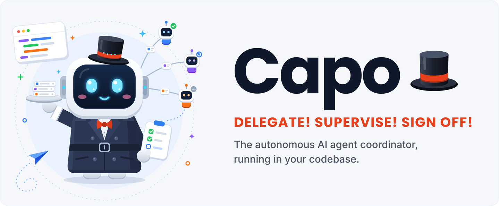
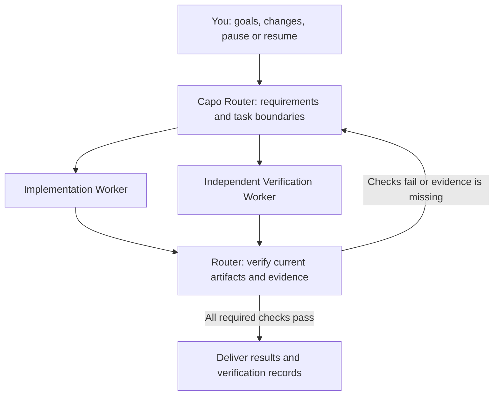

# Capo 🎩 — Your agent coordinator, inside Codex, from goal to delivery

[English](README.en.md) | [Simplified Chinese](README.md)



<p align="center">
  <a href="https://github.com/Yuteng-Chen/capo/actions/workflows/check.yml"></a>
  <a href="LICENSE"></a>
  <a href="VERSION"></a>
  <a href="skills/capo/SKILL.md"></a>
</p>

<p align="center">
  <a href="https://github.com/Yuteng-Chen/capo/stargazers"></a>
  <a href="https://github.com/Yuteng-Chen/capo/forks"></a>
  <a href="https://github.com/Yuteng-Chen/capo/issues"></a>
  <a href="https://github.com/Yuteng-Chen/capo/commits/main/"></a>
</p>

**Set the goal. Capo delegates work, tracks changes, and verifies delivery.**

Capo is a Codex skill that helps the main session coordinate Workers, handle changing requirements, and verify results against evidence. Current version: **0.1.0, preview**. Invoke it with `$capo`.

It is designed for multi-step tasks with work that can run independently. For example, one Worker can implement a tool while another prepares independent test cases. When requirements change, Capo updates the existing tasks and verifies the final artifacts against the new criteria. Simple, sequential tasks can be handled directly by the main session.

[Install and use](#install-and-use) · [Workflow](#workflow) · [Models and budgets](#models-and-budgets) · [Examples and validation](#examples-and-validation) · [FAQ](#faq) · [Feedback and contributions](#feedback-and-contributions)

## Why Capo

When implementation, testing, and requirement changes overlap, you need to know who owns each part, which requirements apply, and what evidence establishes completion. Capo keeps these decisions connected throughout the task:

| Situation | How Capo handles it |
| --- | --- |
| Implementation and verification can proceed independently | Assign different Workers with explicit write boundaries and acceptance criteria |
| Requirements change during execution | Preserve the previous version and update affected tasks and acceptance criteria |
| Only one part of the work needs to pause | Freeze that scope while unrelated work continues |
| A Worker reports that it is done | Inspect and verify the current artifacts; keep criteria without sufficient evidence unverified |

## Capabilities

- Delegate through the host's actual native subagent tools, with a default limit of two concurrent Workers across the entire agent tree.
- Route routine work, complex work, and advanced analysis to suitable models, recording what the current entrypoint actually supports.
- Track requirement, assignment, context, and acceptance versions. Distinguish message acknowledgement, artifact submission, and acceptance.
- Pause A while B continues. Before replacing a Worker, verify that its write domain has been released or isolate the replacement's work.

These are coordination rules followed by an Agent. Process control, file permissions, and sandboxing come from the host. The skill itself does not provide locks, forced termination, a reliable background service, or hard spending limits. Separate worktrees do not enforce permission isolation.

## Workflow

The main session acts as the Router. Workers perform their assigned implementation or verification tasks. You can keep using the main session to ask for progress, change requirements, or pause a specific scope.



The default limit is two concurrent Workers, with zero advanced-analysis calls allowed. If the host cannot meet these requirements, Capo records the limitation and chooses a permitted execution path. See the [coordination protocol](skills/capo/references/coordination-protocol.md) for shared context, assignment versions, scoped pauses, and write-domain handoff rules.

## Install and use

You need a Codex environment that can load local `SKILL.md` files. Multi-agent support depends on the host, account, and available tool permissions. Using the skill does not require this project's Python or Node.js development dependencies.

Clone the repository, or download and extract its ZIP archive:

```sh
git clone https://github.com/Yuteng-Chen/capo.git
cd capo
```

From the repository root, run the following in a macOS or Linux shell:

```sh
skill_parent="${CODEX_HOME:-$HOME/.codex}/skills"
mkdir -p "$skill_parent"
if [ -e "$skill_parent/capo" ] || [ -L "$skill_parent/capo" ]; then
  echo "The target already exists. Back up the previous version before installing."
else
  cp -R skills/capo "$skill_parent/capo"
fi
```

This copies the skill directory. If your host uses another skill location, use the path verified for that host. Open a new session and ask Codex to resolve the installed skill:

```text
Use $capo. First confirm the available subagent tools and models.
Build a small ticket-summary tool in the current project: read a JSON array and output the total and counts by status.
Use different Workers for implementation and verification, with at most two Workers and an advanced-analysis budget of zero.
Keep assignment and acceptance evidence.
```

You can then say, "Pause implementation while verification continues," or, "Keep the total and add counts by priority." Whether an in-flight write has actually stopped must be established from tool evidence.

### Complete example: a ticket-summary tool

This is a copyable interaction example that illustrates the workflow. It is not a log of an actual run.

**1. Give Capo a goal**

```text
Use $capo to build a ticket-summary CLI in the current project.
Read tickets.json and output JSON containing total and byStatus.
byStatus must always include open, closed, and in_progress, including zero counts.
Use at most two Workers and an advanced-analysis budget of zero.
Assign implementation to one Worker and independent fixtures, expected results, and a verification script to another.
Confirm tool availability first and record actual assignments. Do not stop at a plan.
```

Example input:

```json
[
  {"id":"T-1","status":"open","priority":"high"},
  {"id":"T-2","status":"closed","priority":"low"},
  {"id":"T-3","status":"open","priority":"high"}
]
```

Expected V1 output:

```json
{"total":3,"byStatus":{"open":2,"closed":1,"in_progress":0}}
```

**2. Change the requirements during execution**

```text
Keep the existing output and add byPriority with high, normal, and low, including zero counts.
Update the acceptance criteria, send the change to the original implementation and verification Workers, and check that V1 output fails V2 acceptance.
```

Capo should preserve V1, record V2, and notify the affected original Workers. The implementer and verifier each work within their assigned file boundaries.

**3. Check acceptance, not just a Worker's completion report**

Expected V2 output:

```json
{"total":3,"byStatus":{"open":2,"closed":1,"in_progress":0},"byPriority":{"high":2,"normal":0,"low":1}}
```

The delivery should include real Worker identifiers, commands actually run, their results, and acceptance conclusions for these checks:

| Check | Expected result |
| --- | --- |
| The mixed tickets above | Match the expected V2 output |
| An empty array | total is 0; every category key is present and set to 0 |
| Count consistency | Counts in each grouping sum to total |
| V1 output checked against V2 criteria | Rejected because byPriority is missing |

To pause part of the work, say: "Pause CLI implementation. Let the verification Worker continue preparing independent fixtures, but hold checks that require executing the CLI." To resume, say: "Resume CLI implementation using the latest V2 requirements." Capo should check actual stop status, remaining pauses, and current requirements before continuing. Actual delegation depends on host capabilities and budget; Capo reports any fallback it uses.

In the CLI, `codex features list` can help inspect the current version's capabilities. Also check the tools actually exposed to the session. Do not add unverified configuration keys just to install this skill. Use `/goal` only when the host supports it and the user requests a persistent goal. This project does not install a custom `/goal` command.

To upgrade, move the existing skill directory to a backup location, then copy the new version. Avoid merging new files into the old directory. To uninstall, move `capo` out of the skill discovery directory and open a new session. Keep any project run records you need; uninstalling the skill does not delete them.

## Models and budgets

| Role | Purpose | Optional mapping example |
| --- | --- | --- |
| routine | Investigation, organizing information, and small changes | A host-supported Sol model, low |
| complex | Complex implementation, debugging, and independent review | A host-supported Sol model, xhigh |
| analyst | In-depth analysis after evidence has been gathered | A host-supported Astra model, high |

These are mapping examples, not universal model identifiers or Codex configuration keys. Confirm supported models and reasoning settings for the current entrypoint. A model available to desktop subagents may be unavailable in the CLI. Capo does not automatically change providers, API keys, or global model defaults.

The default advanced Worker budget is zero. Astra inheritance and fallback paths are included. If the effective model is unknown, record it as `unknown`. When a strict zero budget cannot be verified, choose a confirmed permitted model or let the Router execute sequentially. This is a workflow limit on Worker rounds, not a billing or token cap. The main-session model already selected by the user is outside the budget for new Worker rounds.

Stop controls should prefer entrypoints that do not start a model round. The default workflow budget permits necessary stop-message exceptions, with actual usage recorded. These exceptions do not override explicit user model prohibitions or hard spending limits. If stopping cannot be performed within those limits, freeze subsequent actions and report that actual termination remains unconfirmed.

## Examples and validation

- [Synthetic run record](examples/synthetic-run.json): contains no real users, sessions, or Worker identifiers; it is not a real execution log.
- [Behavioral scenarios](tests/scenarios.md): exercises for human or independent Agent review, not host integration tests.
- [Local validation record](docs/validation.md): deterministic checks, independent review, and verification limits.

Development checks require Python 3.11+ and Node.js 22+. No pip or npm dependencies are needed. From the repository root, run:

```sh
python3 scripts/check.py
node tests/isolation-check.mjs
```

The first command checks deterministic constraints such as release structure, examples, and local references. The second starts a controlled writer in a temporary directory to test separate-copy writes and shared-link counterexamples. These checks cannot prove that a model will always follow the protocol. GitHub Actions runs the offline checks without API keys, paid model calls, or automatic publication.

Previously observed environments include macOS, local skill discovery with Codex CLI 0.162.1, and historical trials using native desktop subagents. See the validation record for the specific 0.1.0 checks. Full cross-platform compatibility has not been established, and real Codex Worker interruption and lost-Worker recovery have not been tested end to end.

## Repository layout

`skills/capo/` contains the installable skill. `examples/` and `tests/` hold public validation materials. `scripts/` and `.github/workflows/` support offline checks. Generated `work/` directories, credentials, and private session logs are excluded from the release.

## FAQ

**Why can't Codex find `$capo` after installation?**

Make sure you copied the `skills/capo/` directory itself. The host's skill directory should contain `capo/SKILL.md` directly, without an extra repository directory in between. If you use a custom `CODEX_HOME`, check the actual installation location, then open a new session and confirm skill discovery.

**Do I need Node.js or a new API key?**

The skill uses your current Codex models and tool permissions. Python and Node.js are dependencies for this project's offline development checks. Model access, quotas, and authentication remain controlled by your Codex host and account.

**Are Sol and Astra required?**

They are role-mapping examples. Capo should select models supported by the current entrypoint and report unknown effective models honestly. If compliance with the advanced budget cannot be confirmed, do not start that Worker round. The Router may perform permitted work directly, but required independent reviews still need independent evidence before acceptance.

**Will work continue automatically after I close the session?**

Capo does not start a background service. Whether Workers keep running, remain addressable, or continue under a native goal depends on the host. On re-entry, read the run records and check pause, Worker, and artifact states first.

**Why is there no npm installation command?**

The current release consists of Codex Skill files, not a CLI package published to npm. Use the copy-based installation above.

## Feedback and contributions

Submit [bugs or feature requests](https://github.com/Yuteng-Chen/capo/issues/new), or browse existing [Issues](https://github.com/Yuteng-Chen/capo/issues). Documentation improvements, reproducible behavioral scenarios, and validation materials are welcome.

Include the reproducible request, host and version, expected and actual behavior, sanitized evidence, and verification scope. Protocol changes should include a scenario that exposes an incorrect decision. Tests that only match document wording are not a substitute for behavioral verification.

## Design sources and license

The coordination design was informed by [DeepSeek Harness](https://github.com/deepseek-ai/deepseek-harness) and [DSH Superagent Prototype](https://github.com/deepseek-ai/dsh-superagent-prototype). Capo is an independent skill adapted to Codex's native subagent capabilities. Reviewed commits and adaptation boundaries are documented in the source notices.

This project is licensed under the [MIT License](LICENSE). See [Sources and attribution](THIRD_PARTY_NOTICES.md) for provenance and upstream boundaries. Linked protocol and scenario documents currently retain their original language.
