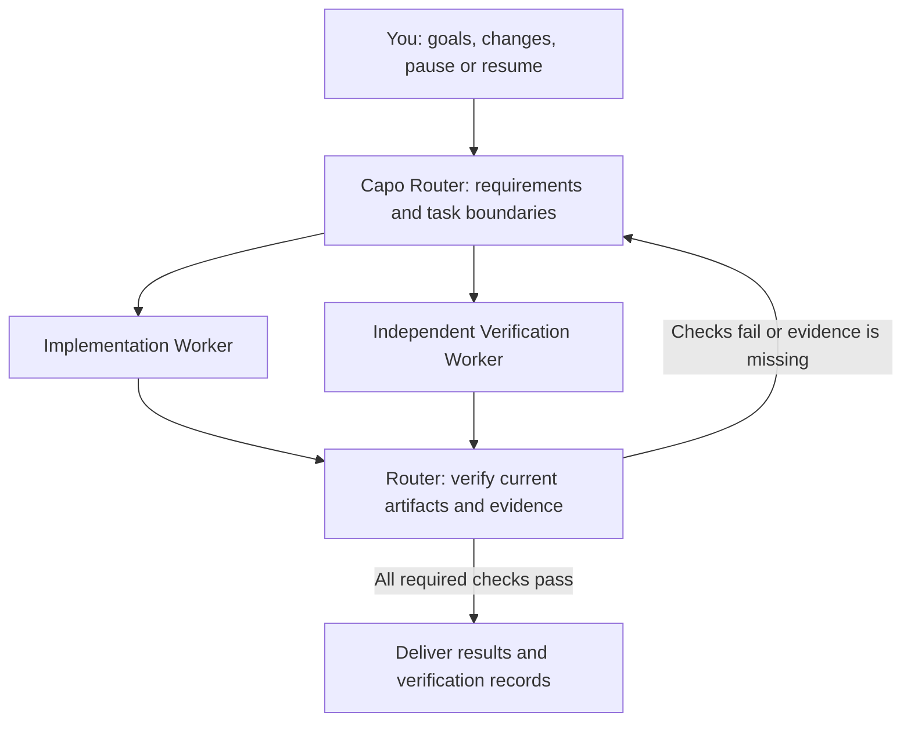

# Capo 🎩 — Your agent coordinator, inside Codex, from goal to delivery

[English](README.md) | [简体中文](README.zh.md)


<p align="center">
  <a href="https://github.com/Yuteng-Chen/capo/actions/workflows/check.yml"></a>
  <a href="LICENSE"></a>
  <a href="VERSION"></a>
  <a href="skills/capo/SKILL.md"></a>
</p>

<p align="center">
  <a href="https://github.com/Yuteng-Chen/capo/stargazers"></a>
  <a href="https://github.com/Yuteng-Chen/capo/forks"></a>
  <a href="https://github.com/Yuteng-Chen/capo/issues"></a>
  <a href="https://github.com/Yuteng-Chen/capo/commits/main/"></a>
</p>

**你定目标，Capo 协调派工、跟进变更、按证据验收。**

一个让 Codex 主会话组织 Worker、接收需求变化并按证据验收的 Skill。当前版本 **0.1.0，预览版**。项目名称为 Capo，调用方式为 `$capo`。

适合可以拆成独立工作的多步骤任务。例如，让一个 Worker 实现工具，另一个准备独立样例；需求变化后续投原任务；最后对照新要求验证产物。简单线性任务可以直接由主会话完成。

[安装使用](#安装与使用) · [工作流程](#工作流程) · [模型与预算](#模型与预算) · [验证材料](#示例与验证) · [常见问题](#常见问题) · [反馈与贡献](#反馈与贡献)

## 为什么用 Capo

当实现、测试和需求变更同时发生时，关键是持续确认“谁负责哪部分、现在按哪版要求做、什么证据能说明完成”。Capo 把这些协调信息留在同一条任务链上：

| 你遇到的情况 | Capo 的处理方式 |
| --- | --- |
| 实现和验证可以独立推进 | 分给不同 Worker，明确文件边界和验收项 |
| 执行到一半改需求 | 保留旧版，更新受影响任务与验收标准 |
| 只想暂停其中一项工作 | 冻结对应范围，无关任务继续 |
| Worker 说“做好了” | 核对当前产物并验证，缺证据的项目保留为未验证 |

## 能做什么

- 用宿主真实提供的子代理能力派工，按独立任务和宿主可用容量安排并发，Capo 不设固定 Worker 数量上限。
- 按常规执行、复杂执行和高级研判分配模型，记录当前入口实际支持的能力。
- 保存需求、分派、上下文和验收版本，区分“消息收到”“交回结果”和“验收通过”。
- 支持“A 暂停、B 继续”；替换 Worker 前核实旧写域释放，或隔离替补工作。

这是由 Agent 执行的调度规则。实际进程停止、文件访问权限和沙箱由宿主提供；Skill 本身不提供锁、强制停止、可靠后台服务或费用硬限额。不能把不同 worktree 当作权限隔离。

## 工作流程

主会话负责 Router，Worker 负责被分配的实现或验证。你可以继续在主会话询问进度、修改要求或指定暂停范围。



Capo 不设固定 Worker 数量上限。Router 根据独立任务、依赖、可写范围和宿主可用容量安排并发，并遵守用户明确设定的限制。宿主容量未知时先核查，再增加 Worker。默认高级研判预算仍为零。实际能力不满足时，会记录限制并选择允许的执行方式。共享上下文、分派版本、暂停与写域交接的细则见 [协调协议](skills/capo/references/coordination-protocol.md)。

## 安装与使用

需要能加载本地 `SKILL.md` 的 Codex 环境。多代理功能取决于当前宿主、账户和工具权限。运行 Skill 无需本项目的 Python/Node 开发依赖。

先克隆项目，也可以下载 ZIP 后解压：

```sh
git clone https://github.com/Yuteng-Chen/capo.git
cd capo
```

从项目根目录，在 macOS/Linux 的 shell 中执行：

```sh
skill_parent="${CODEX_HOME:-$HOME/.codex}/skills"
mkdir -p "$skill_parent"
if [ -e "$skill_parent/capo" ] || [ -L "$skill_parent/capo" ]; then
  echo "目标已存在；请先备份旧版，再安装。"
else
  cp -R skills/capo "$skill_parent/capo"
fi
```

此安装只复制技能目录。若你的宿主使用不同的技能目录，采用该宿主已验证的路径。打开新会话，要求 Codex 读取已安装的 Skill，并确认它能解析该技能：

```text
使用 $capo，先确认可用的子代理工具和模型。
在当前项目实现一个小型工单汇总工具：输入 JSON 数组，输出总数及状态计数。
实现和验证由不同 Worker 负责；按独立任务和宿主可用容量安排并发，高级研判预算为零。
保留派工和验收证据。
```

之后可以继续说“先暂停实现任务，验证任务继续”或“保留总数，新增按优先级汇总”。暂停在途写入是否已生效，必须看实际工具证据。

### 一个完整例子：工单汇总工具

下面是可复制的交互示例，用来说明工作流程；不是本次实际运行日志。

**① 把目标交给 Capo**

```text
使用 $capo，在当前项目做一个工单汇总 CLI。
输入 tickets.json，输出 JSON：total 和 byStatus。
byStatus 固定包含 open、closed、in_progress，零值也要输出。
按独立任务和宿主可用容量安排并发，高级研判预算为零。
一个 Worker 实现 CLI，另一个独立准备样例、预期结果和验证脚本。
先确认工具可用，记录真实派工，不要只给我计划。
```

例如，输入是：

```json
[
  {"id":"T-1","status":"open","priority":"high"},
  {"id":"T-2","status":"closed","priority":"low"},
  {"id":"T-3","status":"open","priority":"high"}
]
```

V1 预期输出：

```json
{"total":3,"byStatus":{"open":2,"closed":1,"in_progress":0}}
```

**② 执行中追加需求**

```text
保留已有输出，再增加 byPriority：high、normal、low，零值也输出。
请更新验收条件，把变化交给原实现和验证 Worker，并检查旧版输出不能通过新验收。
```

Capo 应保留 V1，记录 V2，把变化同步给受影响的原 Worker；实现者和验证者分别处理自己的文件。

**③ 看最终验收，而不只是“Worker 已完成”**

V2 预期输出：

```json
{"total":3,"byStatus":{"open":2,"closed":1,"in_progress":0},"byPriority":{"high":2,"normal":0,"low":1}}
```

交付时应能看到真实 Worker 标识、实际验证命令和结果，以及以下验收结论：

| 检查 | 预期 |
| --- | --- |
| 上面的混合工单 | 与 V2 预期输出一致 |
| 空数组 | total 为 0，所有分类键都存在且为 0 |
| 汇总守恒 | 每个分类维度的数量之和都等于 total |
| 用 V2 标准检查旧版输出 | 因缺少 byPriority 而拒绝 |

如需临时暂停，可以说：“暂停 CLI 实现任务，验证 Worker 继续准备独立样例；需要执行 CLI 的验证先等待。”恢复时说：“恢复 CLI 实现任务，按最新 V2 继续。”Capo 应核查实际停止状态、剩余暂停和最新需求后再续作。实际派工数量取决于宿主能力与预算，无法满足时会说明降级方式。

可在 CLI 中用 `codex features list` 检查当前版本的能力，也要核对会话实际暴露的工具。无需为了安装本 Skill 盲目写入配置键。`/goal` 仅在宿主支持且用户要求持久目标时使用，本项目不安装自定义 `/goal` 命令。

升级时先将已有技能目录移到备份位置，再复制新版本；不要把新文件直接叠加进旧目录。卸载时将 `capo` 目录移出技能搜索目录，重新打开会话。项目运行记录由使用者自行保留，不随技能卸载删除。

## 模型与预算

| 角色 | 用途 | 可选映射示例 |
| --- | --- | --- |
| routine | 调查、资料整理、小改动 | 宿主可用的 Sol，low |
| complex | 复杂实现、排查、独立复核 | 宿主可用的 Sol，xhigh |
| analyst | 证据齐备后的深入研判 | 宿主可用的 Astra，high |

映射示例不是通用模型标识，也不是 Codex 配置键。按当前入口确认模型和推理参数；桌面代理可用的模型可能在 CLI 中不可用。不自动修改 provider、API 密钥或全局默认模型。

高级 Worker 预算默认零，Astra 的继承和降级也受约束。有效模型未知时记录 `unknown`；无法证明满足严格零预算时，选择已确认的允许模型或由 Router 串行执行。预算是工作流轮次约定，不是账单或 token 上限；用户已经选定的主会话模型不计入新增 Worker 预算。

停止控制优先使用不启动模型轮次的入口。默认预算允许必要的停工投递例外并如实记账，但不覆盖用户明确的模型禁令或费用硬限制；无法在限制内停止时，冻结后续动作并报告停工尚未确认。

## 示例与验证

- [合成运行记录](examples/synthetic-run.json)：不含真实用户、会话或 Worker 标识，不是一次真实运行日志。
- [行为演练](tests/scenarios.md)：用于人工或独立 Agent 检查决策；不等于宿主实测。
- [本地验证记录](docs/validation.md)：记录自动检查、独立复核及未覆盖边界。

开发验证需要 Python 3.11+ 和 Node.js 22+。无需 pip/npm 安装依赖，从项目根目录执行：

```sh
python3 scripts/check.py
node tests/isolation-check.mjs
```

前者检查发布结构、示例和本地引用等确定性约束；后者在临时目录启动受控写入进程，验证副本写入及链接反例。这些检查不能证明模型始终遵守协议。GitHub Actions 仅执行离线检查，不使用 API 密钥，不启动付费模型，不自动发布。

已观察环境：macOS、本机 Codex CLI 0.162.1 可发现旧版技能；桌面原生子代理支持历史试跑。0.1.0 的具体本地检查见验证记录。没有宣称跨平台完整兼容，也没有宣称真实 Codex Worker 的中断、失联恢复已经端到端实测。

## 项目结构

`skills/capo/` 是可安装内容；`examples/` 与 `tests/` 是公开验证材料；`scripts/` 和 `.github/workflows/` 用于离线校验。运行产生的 `work/`、凭证和私人会话日志不属于发布内容。

## 常见问题

**安装后找不到 `$capo`？**

确认复制的是 `skills/capo/` 这一层：宿主的技能目录下应直接存在 `capo/SKILL.md`，而不是多嵌套一层仓库目录。使用自定义 `CODEX_HOME` 时检查实际安装位置，然后打开新会话核对技能发现结果。

**还需要安装 Node.js、配置新的 API Key 吗？**

运行 Skill 直接使用当前 Codex 的模型和工具权限。Python 与 Node.js 是本项目离线开发验证的依赖。模型访问、额度和认证仍由你的 Codex 宿主及账户决定。

**一定要有 Sol 或 Astra 吗？**

它们是角色映射示例。Capo 应依据当前入口实际可用的模型选择配置，模型未知时如实记录。无法确认满足高级预算限制时，不启动该 Worker 轮次，可由 Router 执行允许的工作；涉及独立复核的必要项仍须取得独立证据才能通过。

**关闭会话后，会自动在后台继续运行吗？**

Capo 本身不启动后台服务。Worker 是否继续、是否可寻址，以及原生 goal 是否持续执行，都取决于宿主。重新进入时先读取运行记录，并核查暂停、Worker 和产物状态。

**为什么没有 npm 安装命令？**

目前交付的是 Codex Skill 文件，不是发布到 npm 的 CLI 包。使用上面的复制安装方式即可。

## 反馈与贡献

遇到问题可提交 [Bug 或功能建议](https://github.com/Yuteng-Chen/capo/issues/new)，已有讨论见 [Issues](https://github.com/Yuteng-Chen/capo/issues)。欢迎提交文档改进、可复现的行为场景和验证材料。

提交改进时请附：可复现请求、宿主/版本、预期与实际行为、脱敏证据和验证范围。协议修改应补一个能暴露错误决策的场景；不要以匹配文档措辞的测试代替行为验证。

## 设计来源与许可证

调度设计参考了 [DeepSeek Harness](https://github.com/deepseek-ai/deepseek-harness) 和 [DSH Superagent Prototype](https://github.com/deepseek-ai/dsh-superagent-prototype)。Capo 是面向 Codex 原生子代理能力的独立 Skill；具体参考提交与适配范围见来源说明。

本项目采用 [MIT License](LICENSE)。设计来源及上游边界见 [来源说明](THIRD_PARTY_NOTICES.md)。
